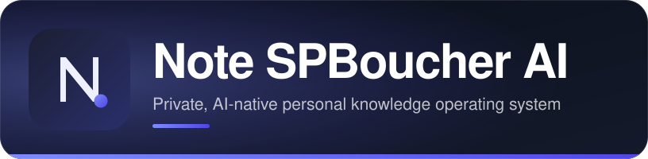
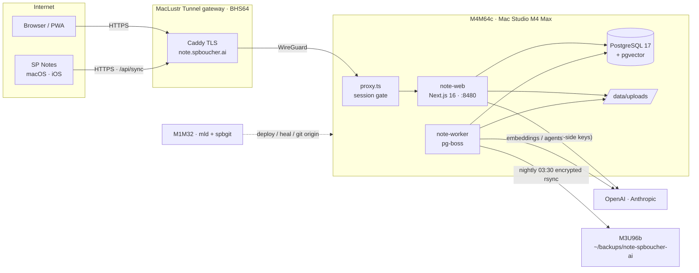
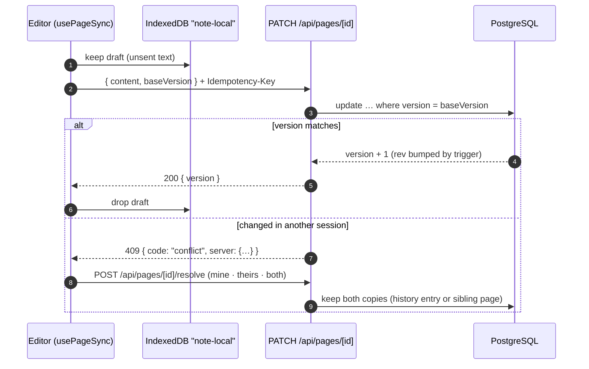
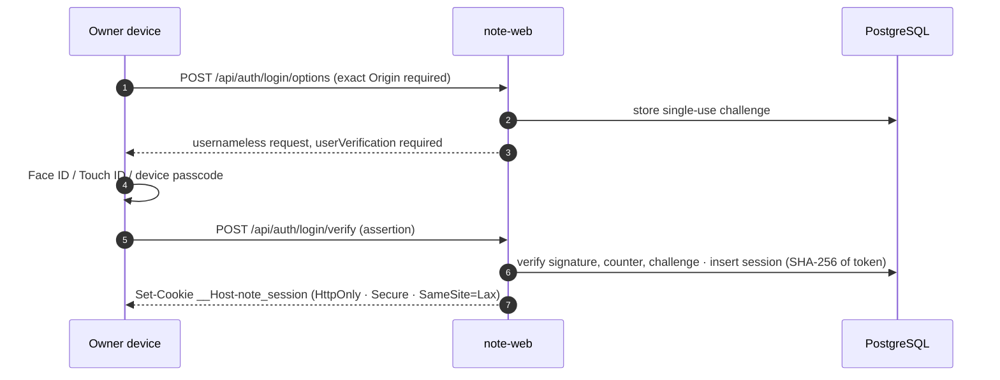
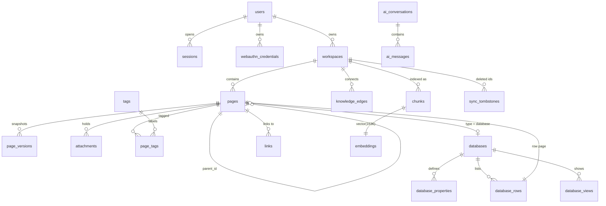

<div align="center">



<br><br>


# Note SPBoucher AI

**Private, AI-native personal knowledge operating system for one owner — phone-first capture, a block editor, Notion-style databases, hybrid semantic search with cited answers, a knowledge graph, a research workspace and bounded AI agents, on a single PostgreSQL.**

**Author: [Simon-Pierre Boucher](https://www.spboucher.ai)**

[](https://note.spboucher.ai)


[](https://git.spboucher.ai/note-spboucher-ai/commits)
[](https://git.spboucher.ai/note-spboucher-ai/commits)
[](https://git.spboucher.ai/note-spboucher-ai/insights)
[](https://git.spboucher.ai/note-spboucher-ai)
[](https://git.spboucher.ai/note-spboucher-ai/insights)
[](https://git.spboucher.ai/note-spboucher-ai)
[](https://git.spboucher.ai/note-spboucher-ai/branches)
[](https://git.spboucher.ai/note-spboucher-ai/tags)
[](https://git.spboucher.ai/note-spboucher-ai)


</div>

---

## Table of contents

- [Overview](#-overview)
- [Features](#-features)
- [Architecture](#-architecture)
- [Stack](#-stack)
- [Repository layout](#-repository-layout)
- [Getting started](#-getting-started)
- [Configuration](#-configuration)
- [Access model](#-access-model)
- [Screens](#-screens)
- [API](#-api)
- [Native sync feed](#-native-sync-feed)
- [Data model](#-data-model)
- [Background worker](#-background-worker)
- [AI: model routing and agents](#-ai-model-routing-and-agents)
- [Import and export](#-import-and-export)
- [Security and privacy](#-security-and-privacy)
- [Testing](#-testing)
- [Deployment (MacLustr, `mld`)](#-deployment-maclustr-mld)
- [Operations](#-operations)
- [Troubleshooting and gotchas](#-troubleshooting-and-gotchas)
- [Known limitations](#-known-limitations)
- [Changelog](#-changelog)
- [Documentation](#-documentation)
- [Author](#-author)
- [License](#-license)

---

## 🎯 Overview

Private, AI-native personal knowledge operating system for one owner — production: **https://note.spboucher.ai**.

Phone-first: quick capture to an inbox, an editor built for the thumb, offline drafts. Pages with a block editor,
Notion-style databases, hybrid semantic search with grounded answers and citations, a knowledge graph with AI-suggested
links, a research workspace, controlled AI agents and encrypted backups — on **one PostgreSQL**, served from a Mac Studio
of the MacLustr cluster through the MacLustr Tunnel.

- **One owner.** No multi-user feature, no roles; the schema carries a workspace but there is a single owner row.
- **Passkeys only.** No password, no PIN typed into the app, no secret link.
- **One process for UI + API** and **one database for everything** (relational core, JSONB blocks, embeddings,
  full text, job queue). No Redis, no Docker, no external search engine.
- **Native clients.** Since migration `0002_native_sync` the server exposes a change feed (`GET /api/sync`) that the
  SP Notes apps for macOS and iOS use to keep a full local copy.

### Family

| Repository | Role | Platform |
|---|---|---|
| **[note-spboucher-ai](https://git.spboucher.ai/note-spboucher-ai)** (this one) | Web app, API, worker, database, sync feed | Web / PWA — note.spboucher.ai |
| [sp-notes-core](https://git.spboucher.ai/sp-notes-core) | Shared Swift package used by both native apps | Swift |
| [sp-notes-macos](https://git.spboucher.ai/sp-notes-macos) | SP Notes for Mac (bundle `ai.spboucher.spnotes`) | macOS |
| [sp-notes-ios](https://git.spboucher.ai/sp-notes-ios) | SP Notes for iPhone and iPad (bundle `ai.spboucher.spnotes.ios`) | iOS / iPadOS |

The two bundle identifiers above are the ones this server publishes in
[`/.well-known/apple-app-site-association`](src/app/.well-known/apple-app-site-association/route.ts) so the native apps
can use the passkeys of the domain.

## ✨ Features

| Area | What you get |
|---|---|
| **Editor** | Tiptap 3 / ProseMirror JSON: headings, lists, task lists, tables, code (lowlight), KaTeX math, callouts, toggles, `@` page mentions, `/` slash menu, drag handles, files/images, YouTube; autosave (800 ms debounce) with **version-checked saves** — a note changed in two sessions is never overwritten: Compare / Keep mine / Keep theirs / Keep both, both copies kept; unsent text survives a closed tab or a dead network (IndexedDB draft, replayed once); version history (≤ 200 snapshots), covers (gradient gallery or URL) and emoji icons. |
| **Databases** | Table · Board · List · Gallery · Calendar · Timeline views; relations, rollups, formulas, AI properties; filters/sorts/grouping; CSV import; templates (Research papers, Tasks, Reading list); sticky headers, consistent 36 px rows, keyboard cell navigation. |
| **Search & RAG** | Hybrid retrieval — pgvector HNSW (cosine, `text-embedding-3-small`) + `tsvector` (fr/en) + `pg_trgm`, reciprocal-rank fusion; filters by type / space / date, highlighted excerpts, results that open at the exact paragraph and survive Back, pending/failed indexing shown with re-index commands; ⌘K palette (titles ↔ content with Tab); RAG chat panel with numbered citations rendered as chips that jump to the cited block. |
| **Knowledge graph** | Canvas force graph (pages, databases, rows, research, files, tags), filters, AI-suggested links to review, per-page connections card, backlinks explorer. |
| **AI** | Measured routing across OpenAI + Anthropic (task classes, fallbacks, refusal retry, daily budget guard), inline AI on selection (⌘J), model dashboard and side-by-side compare, usage and cost per call. |
| **Agents** | Fixed tool allow-list, proposals with approval before writes, execution log. Four fixed tasks: *Sort my inbox*, *Suggest tags*, *Make a plan from this page*, *Check references*. |
| **Research** | References (BibTeX/DOI import, `.bib` export), PDFs, experiments, tasks, LaTeX snippets. |
| **Capture & inbox** | One-tap capture from anywhere (note, to-do list, link, photo, file/scan, voice memo, dictation where the browser allows) — no space or template to choose, works offline and is sent exactly once. Daily inbox review: file in a space, turn into tasks, add to a database, save as a reference (DOI lookup), tag, archive — every action has Undo. |
| **Phone** | Bottom bar (Home · Search · Capture · Inbox · More), header with a real Back, drawer with favourites/recent/spaces, editing bar docked above the keyboard (contextual for tables, code, images), sheets instead of popovers, uploads with progress/cancel/retry, databases as cards, connections as lists, every screen checked at 360 px. |
| **Shell (desktop)** | Sidebar with workspace tree, databases, favourites, ⌘K search and quick capture; breadcrumb top bar; focus mode; keyboard-shortcut sheet (⌘?); PWA (installable; only the app shell is cached, never notes). |
| **Design** | "Graphite & Ultramarine" tokens (OKLCH), designed light *and* dark themes, 16 px / 1.75 reading type, 46 rem measure, skeletons, empty states, visible focus rings, `prefers-reduced-motion` honoured. |
| **Data ownership** | Import Markdown/Notion ZIP/DOCX/PDF/CSV/BibTeX/JSON; export Markdown/HTML/CSV/JSON/ZIP; nightly encrypted backups with off-node copy and a tested restore. |
| **Native clients** | Change feed `GET /api/sync` (revisions, tombstones), client-chosen ids for pages and attachments, apple-app-site-association for passkeys in SP Notes. |

<details>
<summary><b>Saves, conflicts, offline and the installed app — exact behaviour</b></summary>

- **Autosave**: 800 ms after the last keystroke, one request at a time, with the version the edit was based on. States
  shown next to the title: *Saved · Saving · Offline (kept on this device) · Not saved (Retry) · Conflict*.
- **Conflict** (the same note changed in another session): the server refuses the stale save (`409`), nothing is
  overwritten, and the note shows *Compare / Keep mine / Keep theirs / Keep both*. Both copies always remain: the
  discarded one is a version-history entry, or a sibling page "… (conflict copy)".
- **Offline**: the unsent text of a page and captures made offline are stored in the browser (IndexedDB `note-local`)
  and sent when the network returns — once: captures carry an idempotency key, page saves a base version. Reading notes
  offline is **not** supported in the web app: notes are never cached on the device (only the generic offline page is).
- **Retention on the device**: until confirmed by the server, 30 days at most; erased by *Lock this device* and by
  signing out everywhere. Not encrypted (see [`docs/security.md`](docs/security.md)).
- **History**: up to 200 entries per page (snapshot at the first change, every 20 saves, every 10 minutes, before a
  restore, and at each conflict).
- **Installed app (PWA)**: iOS — Safari → Share → *Add to Home Screen*; Android — Chrome's install prompt. The service
  worker caches only build assets, icons, the manifest and the offline page. After a deployment the app shows
  *A new version is ready → Reload* and never reloads in the middle of an edit. Manifest shortcuts: Quick capture,
  Search, Inbox.
- **Nothing is deleted automatically**: the trash keeps pages until *Delete forever* / *Empty trash* /
  *Delete items older than 30 days* is pressed (each asks for the passkey again).

</details>

## 🏗 Architecture



- **One process for UI + API** (App Router, route handlers, SSE streaming); secrets never leave the server.
- **One database for everything**: relational core, JSONB blocks, embeddings, full-text, job queue (pg-boss uses
  `SKIP LOCKED`).
- **Network boundary**: [`src/proxy.ts`](src/proxy.ts) checks the session against the database *before* any page or
  route handler runs, and every handler checks again next to the data (`handler()` in [`src/lib/api.ts`](src/lib/api.ts)).
- No management interface is exposed: PM2, PostgreSQL and the worker listen on localhost only; only port 8480 is
  reachable, and only through the tunnel.

### Version-checked save



### Passkey sign-in



More detail (cluster findings, performance budgets, justification of each choice):
[`docs/architecture.md`](docs/architecture.md).

## 🧱 Stack

Versions are the ones resolved in [`pnpm-lock.yaml`](pnpm-lock.yaml).

| Layer | Technology | Version | Role |
|---|---|---|---|
| Web + API | Next.js (App Router), React | 16.4.3 · 19.3.1 | UI, route handlers, SSE streaming, PWA shell |
| Language | TypeScript (strict) | 7.0.2 | `tsc --noEmit` is both `typecheck` and `lint` |
| UI | Tailwind CSS, Radix UI primitives, Motion, lucide-react, cmdk | 4.3.3 | Themes by CSS variables, sheets, command palette |
| Editor | Tiptap / ProseMirror | 3.32.2 | Document stored as ProseMirror JSON, never HTML |
| Math / code | KaTeX, lowlight | 0.16.47 · 3.3.0 | Client-side rendering |
| Data | PostgreSQL + pgvector, `pg_trgm`, `unaccent` | 17 | Relational core, JSONB, embeddings, full text |
| ORM | Drizzle ORM on postgres.js; drizzle-kit | 0.45.4 · 4.0.0 | SQL-first migrations, each with a `.down.sql` |
| Jobs | pg-boss | 12.38.0 | Durable queue in the same database (no Redis) |
| Access | `@simplewebauthn/server` + `@simplewebauthn/browser` | 14.1.0 | Passkeys; no hand-written WebAuthn cryptography |
| AI | `openai`, `@anthropic-ai/sdk` | 7.47.0 · 1.3.0 | Behind `src/lib/ai/router.ts` |
| Graph | react-force-graph-2d | 1.29.2 | Canvas force graph |
| Client state | TanStack Query, Zustand | 5.105.0 · 5.0.16 | Server cache, shell state |
| Validation | Zod | 4.6.7 | Request bodies and documents |
| Import / export | pdf-parse, mammoth, turndown, marked, papaparse, jszip, bibtex-parse-js | — | Data ownership |
| Logs | pino | 10.4.0 | JSON lines with ids only, never content |
| Tests | `node:test` through tsx, Playwright (Chromium) | 4.23.15 · 1.65.1 | Unit/integration and end-to-end |
| Process | PM2 (`note-web`, `note-worker`), `mld` | — | MacLustr supervision |

Components deliberately **not** added: Redis (pg-boss + database sessions), Docker (PM2 is the cluster standard),
Elasticsearch/Qdrant (pgvector suffices at personal scale), an external auth provider (single owner).

## 🗂 Repository layout

411 tracked files.

```
note-spboucher-ai/
├── src/
│   ├── app/
│   │   ├── (app)/              # 14 authenticated pages (home, p/[id], inbox, search, graph, research, ai/*, settings…)
│   │   ├── login/ enroll/ offline/   # the 3 public pages
│   │   ├── api/                # 82 route files (see API)
│   │   └── .well-known/apple-app-site-association/   # passkeys for the native apps
│   ├── components/             # 114 files: shell, editor, database, graph, research, ai, inbox, settings, auth, ui
│   ├── lib/
│   │   ├── auth/               # WebAuthn, sessions, enrollment windows, rate limit, guard
│   │   ├── ai/                 # router, providers, catalogue, prompts, usage
│   │   ├── agents/             # definitions (4 tasks), runner, tools, apply
│   │   ├── databases/          # query engine, formulas, values, templates, CSV
│   │   ├── search/             # chunking, embeddings, hybrid retrieval
│   │   ├── graph/ research/ inbox/ pages/ files/
│   │   ├── import/ export/     # Markdown, Notion ZIP, DOCX, PDF, CSV, BibTeX, JSON
│   │   ├── jobs/               # queues + per-queue policy
│   │   └── client/             # page-sync, offline drafts, capture outbox, passkey
│   ├── db/                     # schema.ts (39 tables), migrate.ts
│   ├── worker/                 # pg-boss worker + 7 handlers
│   ├── cli/                    # auth.ts, bootstrap.ts, seed-ai-models.ts
│   ├── proxy.ts                # network boundary (Next.js 16 proxy)
│   └── instrumentation.ts
├── drizzle/                    # 3 migrations, each with a .down.sql, + meta snapshots
├── tests/
│   ├── unit/                   # 8 node:test suites
│   ├── e2e/                    # 4 Playwright specs + manual helper scripts
│   └── helpers/                # software authenticator, scratch database
├── benchmarks/                 # Phase Zero: prompts, scripts, results (discovery.json, summary.json)
├── scripts/                    # backup.sh, restore.sh, smoke.sh, dev-session.ts
├── public/                     # manifest.webmanifest, sw.js, icons
├── docs/                       # 11 documents + brand/
└── package.json · pnpm-lock.yaml · drizzle.config.ts · playwright.config.ts · next.config.ts
```

## 🚀 Getting started

```bash
pnpm install
cp .env.example .env              # fill secrets (never commit)
pnpm db:migrate && pnpm seed:ai   # schema + AI model catalogue from benchmarks/results
pnpm run bootstrap                # owner row + workspace (no password: access is by passkey)
pnpm auth:open-enrollment         # one-time link to register the first passkey
pnpm dev                          # use another port and a *_dev database, never the production folder
pnpm worker                       # background jobs (indexing, imports, backups, agents)
pnpm typecheck                    # tsc --noEmit
pnpm test                         # unit/integration (WebAuthn attacks, sessions, conflicts, inbox, jobs) on a *_dev database
pnpm test:e2e                     # Playwright: passkey journeys (virtual authenticator) + phone journeys at 360/375/430 px
pnpm build && pnpm start          # production
pnpm bench:discover && pnpm bench:run && pnpm bench:report && pnpm seed:ai   # re-run Phase Zero
bash scripts/smoke.sh             # post-deploy smoke test (public surface, no credential)
```

PostgreSQL needs the extensions `vector`, `pg_trgm` and `unaccent`, created by a superuser (the app role cannot create
extensions).

<details>
<summary><b>All <code>package.json</code> scripts</b></summary>

| Script | Command |
|---|---|
| `dev` | `next dev -p 8480` |
| `build` · `start` | `next build` · `next start -p 8480` |
| `worker` | `tsx src/worker/index.ts` |
| `typecheck` · `lint` | `tsc --noEmit` |
| `db:generate` · `db:migrate` · `db:studio` | drizzle-kit generate · `tsx src/db/migrate.ts` · drizzle-kit studio |
| `bootstrap` | `tsx src/cli/bootstrap.ts` |
| `auth:status` · `auth:open-enrollment` · `auth:recover` · `auth:close-enrollment` · `auth:revoke-sessions` | `tsx src/cli/auth.ts <command>` |
| `seed:ai` | `tsx src/cli/seed-ai-models.ts` |
| `backup` · `restore` | `bash scripts/backup.sh` · `bash scripts/restore.sh` |
| `bench:discover` · `bench:run` · `bench:report` | `tsx benchmarks/scripts/{discover,bench,report}.ts` |
| `test` | `tsx --test --test-force-exit --test-concurrency=1 tests/unit/*.test.ts` |
| `test:e2e` | `playwright test` |

</details>

Conventions (phone-first UI rules, `handler()` wrapper, migrations, logging):
[`docs/dev-conventions.md`](docs/dev-conventions.md).

## ⚙️ Configuration

All values live only in the node's `.env` (mode 600, never committed; template [`.env.example`](.env.example); the
owner keeps a copy of record outside the repository). `mld` never overwrites it.

| Variable | Purpose |
|---|---|
| `NODE_ENV`, `PORT`, `TZ` | runtime (`production`, `8480`, `America/Toronto`) |
| `APP_URL` | public origin — the **only** origin accepted for passkeys and mutating requests; its host is the passkey RP ID |
| `AUTH_RP_ID` | optional; leave unset (changing it invalidates every passkey) |
| `AUTH_EXTRA_ORIGINS` | development only (ignored in production): extra accepted origins |
| `APP_VERSION` | shown by `/api/health` |
| `DATABASE_URL` | PostgreSQL connection (localhost) |
| `OPENAI_API_KEY`, `ANTHROPIC_API_KEY` | providers (server-side only) |
| `CROSSREF_MAILTO` | optional contact address sent to Crossref for DOI lookups ("polite pool") |
| `APPLE_APP_IDS` | optional, comma-separated application identifiers that override the default list of the apple-app-site-association |
| `DATA_DIR` | uploads root (`./data`) |
| `BACKUP_DIR`, `BACKUP_PASSPHRASE`, `BACKUP_OFFSITE`, `BACKUP_KEEP_DAYS` | encrypted backups and off-site target |
| `LOG_LEVEL` | pino level |
| `E2E_BASE_URL` | tests only: target of the Playwright suite (default `http://localhost:8481`) |
| `ACCESS_KEY`, `ACCESS_PASSWORD_HASH`, `SESSION_SECRET`, `WEBAUTHN_RP_ID`, `WEBAUTHN_ORIGIN`, `OWNER_INITIAL_PASSWORD` | obsolete since 2.0 — ignored; delete them from `.env` after the first passkeys are enrolled |

## 🔑 Access model

**Passkeys only** (WebAuthn) — no password, no PIN typed into the app, no secret link. The device confirms it is you
with Face ID, Touch ID, a fingerprint or its passcode; the server stores a public key and never anything biometric.

| Item | Value |
|---|---|
| Sign-in | `/login` → *Continue with Face ID / Touch ID / your passkey* (usernameless, user verification required) |
| Sessions | random 256-bit token, SHA-256 stored server-side, cookie `__Host-note_session` (HttpOnly · Secure · SameSite=Lax), idle 30 days, max 90 days, rotated at sign-in and at each step-up, revocable per device or globally |
| Sensitive actions | passkey again if the last verification is older than 5 minutes (passkey management, signing other devices out, whole-workspace export, permanent deletion) |
| First passkey / recovery | only through a one-time link opened from the node shell: `pnpm auth:open-enrollment` (first passkey, 15 min) · `pnpm auth:recover` (all devices lost). The window closes after one registration and at every restart. |
| Manage | Settings → Security: add / rename / remove passkeys (never the last one), devices & sessions, lock this device, activity log |
| Origin / RP ID | `https://note.spboucher.ai` / `note.spboucher.ai` (from `APP_URL`) |
| Native apps | `/.well-known/apple-app-site-association` lists the SP Notes macOS and iOS application identifiers under `webcredentials` (no `applinks`: every web address stays in the browser) |

Shell commands: `pnpm auth:status | auth:open-enrollment [min] | auth:recover [min] [--keep-passkeys] |
auth:close-enrollment | auth:revoke-sessions`. Full model, limits and runbooks (stolen session, lost devices):
[`docs/security.md`](docs/security.md).

## 🖥 Screens

17 pages: 3 public, 14 behind the session.

| Path | Screen |
|---|---|
| `/login` | Passkey sign-in |
| `/enroll` | One-time enrollment link (first passkey / recovery) |
| `/offline` | Generic offline page (the only HTML the service worker caches) |
| `/` | Home dashboard (widgets, summary) |
| `/p/[id]` | A page: editor, database or research workspace |
| `/inbox` | Capture inbox and daily triage |
| `/archive` | Archived pages |
| `/search` | Hybrid search with filters |
| `/tasks` | Tasks inbox |
| `/graph` | Knowledge graph explorer |
| `/backlinks` | Backlinks explorer |
| `/research` | Research overview |
| `/ai/models` | Model dashboard (catalogue, heatmap, routing, usage) |
| `/ai/compare` | Side-by-side model comparison with votes |
| `/ai/agents` | Agents console (proposals, execution log) |
| `/settings` | Profile, appearance, security, AI, data, indexing, jobs, tasks, about |
| `/trash` | Trash with restore |

## 🔌 API

83 route files exporting 137 HTTP handlers (53 `GET`, 52 `POST`, 14 `PATCH`, 16 `DELETE`, 2 `PUT`). Everything except
the rows marked *public* answers `401` without a session; mutating requests require the exact `Origin` of `APP_URL` and
honour an `Idempotency-Key`.

<details open>
<summary><b>Auth, health and native clients</b></summary>

| Route | Methods | Notes |
|---|---|---|
| `/api/health` | GET | public — `{ ok, db, pgvector, worker, passkeys, version }`, booleans only |
| `/.well-known/apple-app-site-association` | GET | public — `webcredentials` for SP Notes |
| `/api/auth/login/options` · `/verify` | POST | public — sign-in ceremony |
| `/api/auth/enroll/options` · `/verify` | POST | public — only with a valid one-time enrollment token |
| `/api/auth/logout` | POST | public |
| `/api/auth/state` | GET | current session state |
| `/api/auth/reauth/options` · `/verify` | POST | step-up for sensitive actions |
| `/api/auth/passkeys` | GET | list passkeys |
| `/api/auth/passkeys/options` · `/verify` | POST | add a passkey |
| `/api/auth/passkeys/[id]` | PATCH · DELETE | rename · remove (never the last one) |
| `/api/auth/sessions` | GET · DELETE | devices and sessions · sign out the others |
| `/api/auth/sessions/[id]` | DELETE | revoke one session |
| `/api/sync` | GET | change feed for native clients (see below) |

</details>

<details>
<summary><b>Pages, capture, inbox, tags, tasks, files</b></summary>

| Route | Methods |
|---|---|
| `/api/pages` | GET · POST |
| `/api/pages/[id]` | GET · PATCH · DELETE · POST |
| `/api/pages/[id]/resolve` | POST |
| `/api/pages/[id]/beacon` | POST |
| `/api/pages/[id]/versions` | GET · POST |
| `/api/pages/[id]/tags` | GET · PUT |
| `/api/tree` | GET |
| `/api/capture` | POST |
| `/api/inbox` | GET |
| `/api/inbox/[id]` | POST |
| `/api/inbox/undo` | POST |
| `/api/tags` | GET |
| `/api/tasks` | GET · POST · PATCH · DELETE |
| `/api/trash` | POST · DELETE |
| `/api/attachments` | GET · POST · DELETE |
| `/api/files/[id]` | GET |

</details>

<details>
<summary><b>Databases</b></summary>

| Route | Methods |
|---|---|
| `/api/databases` | GET |
| `/api/databases/templates` | GET |
| `/api/databases/[id]` | GET · PATCH |
| `/api/databases/[id]/properties` | POST · PATCH · DELETE |
| `/api/databases/[id]/rows` | GET · POST · PATCH · DELETE |
| `/api/databases/[id]/rows/restore` | POST |
| `/api/databases/[id]/views` | GET · POST · PATCH · DELETE |
| `/api/databases/[id]/query` | GET · POST |
| `/api/databases/[id]/import` | POST |
| `/api/databases/[id]/duplicate` | POST |
| `/api/databases/[id]/apply-template` | POST |
| `/api/databases/[id]/ai` | POST |

</details>

<details>
<summary><b>Search, graph, research</b></summary>

| Route | Methods |
|---|---|
| `/api/search` | GET |
| `/api/search/duplicates` | GET |
| `/api/search/index-state` | GET · POST |
| `/api/graph` | GET |
| `/api/graph/neighbors` | GET |
| `/api/graph/backlinks` | GET · POST |
| `/api/graph/suggestions` | GET · POST · PATCH |
| `/api/research/overview` | GET |
| `/api/research/papers` | POST |
| `/api/research/ai` | POST |
| `/api/research/references` | GET · POST |
| `/api/research/references/[id]` | GET · PATCH · DELETE · POST |
| `/api/research/references/[id]/extracts` | GET · POST · PATCH · DELETE |
| `/api/research/references/[id]/links` | GET |
| `/api/research/references/doi` | GET · POST |
| `/api/research/references/import-bibtex` | POST |
| `/api/research/references/export.bib` | GET |
| `/api/research/experiments` | GET · POST |
| `/api/research/experiments/[id]` | PATCH · DELETE |
| `/api/research/tasks` | GET · POST |
| `/api/research/tasks/[id]` | PATCH · DELETE · POST |

</details>

<details>
<summary><b>AI, agents, dashboard, settings, data, jobs</b></summary>

| Route | Methods |
|---|---|
| `/api/ai/chat` | POST |
| `/api/ai/chat/plan` | GET |
| `/api/ai/action` | POST |
| `/api/ai/conversations` | GET · PATCH · DELETE |
| `/api/ai/models` | GET · POST |
| `/api/ai/usage` | GET |
| `/api/ai/compare` | GET · POST |
| `/api/ai/compare/vote` | GET · POST |
| `/api/agents` | GET · POST |
| `/api/agents/[id]` | GET · POST |
| `/api/dashboard` | GET · PUT |
| `/api/dashboard/summary` | GET · POST |
| `/api/settings` | GET · PATCH |
| `/api/settings/audit` | GET |
| `/api/export` | GET |
| `/api/import` | GET · POST · DELETE |
| `/api/jobs` | GET · POST |

</details>

## 🔄 Native sync feed

`GET /api/sync?since=<rev>&limit=<n>` ([`src/app/api/sync/route.ts`](src/app/api/sync/route.ts), migration
[`0002_native_sync`](drizzle/0002_native_sync.sql)) is the change feed used by SP Notes on macOS and iOS, which keep a
full local copy.

| Aspect | Behaviour |
|---|---|
| Returns | everything whose revision is greater than `since`, oldest first: whole pages (content included, in every state — live, inbox, archived, in the trash), attachment metadata, tombstones of permanently deleted rows, plus the tag list and workspace name |
| `cursor` | the revision to send next time; `since=0` is a full copy |
| `more: true` | the answer was cut at `limit` (default 200, maximum 500): call again at once. The cursor stops at the lowest cut point and the other lists are trimmed to it, so nothing is skipped |
| `reset: true` | the client's cursor is ahead of the server (database restored from an older backup): start again from zero |
| Revisions | one workspace-wide sequence (`sync_rev_seq`) taken under a transaction-level advisory lock, so revisions become visible in commit order: a client that has seen revision N has seen every change numbered ≤ N |
| Triggers | every write to a page or an attachment, whatever code path made it (editor save, import, agent, inbox triage, trash, restore, tags), gets the next revision; opening a note (`last_opened_at`) is not a change |
| Side effects | none — read-only; nothing is marked as opened |

Writes from native clients go through the same page and attachment routes as the web app. `POST /api/pages` accepts a
client-chosen `id` (UUID): when a page with that id already exists in any state it is returned as is (`200`, header
`x-existing: 1`), so a retried creation never duplicates a note.

## 🗃 Data model

39 tables in [`src/db/schema.ts`](src/db/schema.ts) (Drizzle), plus the `pgboss` schema managed by pg-boss.

| Group | Tables |
|---|---|
| Identity and access | `users`, `sessions`, `login_attempts`, `webauthn_credentials`, `webauthn_challenges`, `auth_enrollments`, `idempotency_keys` |
| Content | `workspaces`, `pages`, `page_versions`, `attachments`, `tags`, `page_tags`, `tasks`, `inbox_actions` |
| Databases | `databases`, `database_properties`, `database_rows`, `database_views`, `relations` |
| Graph | `links`, `knowledge_edges` |
| Search | `chunks`, `embeddings`, `index_state` |
| Native sync | `sync_tombstones` (+ `rev` on `pages` and `attachments`, sequence `sync_rev_seq`) |
| AI | `ai_providers`, `ai_models`, `ai_conversations`, `ai_messages`, `ai_executions`, `ai_usage`, `ai_comparisons` |
| Research | `references`, `experiments` |
| Operations | `audit_logs`, `backup_jobs`, `dashboard_layouts`, `settings` |



- `pages`: tree via `parent_id`; `type` page · database · research; `content` is ProseMirror JSON, `text` is plain,
  `tsv` is generated; `version` is the optimistic-concurrency token; `rev` is the sync revision; captures are pages with
  `inbox_at`; archived pages leave the tree but stay searchable.
- Content tables carry `deleted_at` (soft delete, trash with restore) and `updated_at`.
- `embeddings` carry `model` and `version`, so a model change triggers re-indexing and never mixes vector spaces.

| Migration | Content |
|---|---|
| [`0000_init`](drizzle/0000_init.sql) | first schema |
| [`0001_v2_passkeys_inbox`](drizzle/0001_v2_passkeys_inbox.sql) | additive: `auth_enrollments`, `idempotency_keys`, `inbox_actions`; nullable columns on `pages` (`inbox_at`, `capture_kind`), `sessions`, `webauthn_challenges`, `webauthn_credentials`; revokes the dead v1 sessions |
| [`0002_native_sync`](drizzle/0002_native_sync.sql) | additive: `rev` on `pages` and `attachments`, `sync_tombstones`, sequence, three trigger functions |

Each migration has a `.down.sql`; the rollback command is in the header of each down file.

## 🛠 Background worker

One process (`note-worker`), pg-boss on the same PostgreSQL. Policy per queue
([`src/lib/jobs/queues.ts`](src/lib/jobs/queues.ts)):

| Queue | Work | Automatic retries | Time limit | Notes |
|---|---|---|---|---|
| `index-source` | chunk + embed one page/file | 4, exponential backoff from 15 s | 5 min | idempotent by content hash |
| `reindex-all` | whole workspace | 1 | 60 min | unchanged content skipped |
| `import-file` | staged import | 1 | 60 min | resumable (created items are recorded) |
| `backup` | `scripts/backup.sh` | **none** | 4 h | nightly `30 3 * * *` America/Toronto; a failure waits for a human |
| `agent-run` | one agent execution | **none** | 15 min | never re-billed behind your back |
| `suggest-links` | AI link suggestions | **none** | 10 min | explicit action only |
| `ai-property` | one AI database cell | 1 | 5 min | |
| `maintenance` | hourly housekeeping (`17 * * * *`) | none | 5 min | deletes expired technical rows only |

A job that exhausts its retries is copied to the `dead-letter` queue. Retries with backoff exist only for work that is
safe to repeat; anything that calls a paid model with side effects is never retried automatically. Each attempt writes
one JSON log line (`queue`, `job`, `attempt`, `ms`, outcome) — never payload content. The worker writes a heartbeat
every 30 s; `/api/health` reports `worker:false` after 2 minutes without one.

## 🤖 AI: model routing and agents

### Model routing

Measured on 2026-11-01 (836 runs, 38 models); the table is seeded into `ai_models` and read by
[`src/lib/ai/router.ts`](src/lib/ai/router.ts) — see [`docs/ai-routing-strategy.md`](docs/ai-routing-strategy.md).

| Task class | Primary | Fallback | Notes |
|---|---|---|---|
| `chat` — RAG Q&A | `gpt-6-sol` | `claude-sonnet-5-5` | citations required |
| `quick` — titles, tags, AI properties | `claude-haiku-5-5` | `gpt-5.4-mini` | low effort |
| `write` — drafting, FR/EN | `gpt-6-sol` | `claude-sonnet-4-6` | |
| `reason` — maths, contradictions | `claude-opus-5-5` | `gpt-6-astra` | high effort |
| `deep` — research synthesis | `claude-fable-5-1` | `gpt-6-astra` | cost warning |
| `code` | `gpt-5.3-codex` | `claude-sonnet-5-5` | |
| `extract` — JSON | `gpt-5.4-mini` | `claude-haiku-5-5` | strict schema |
| `longctx` — > 60K tokens | `gpt-6.1-terra` | `claude-sonnet-5-5` | never the 3 refusing models |
| `agent` — tool loops | `claude-sonnet-5-5` | `gpt-5.4` | approval gates |
| `judge` | `claude-haiku-5-5` | `gpt-5.4-mini` | |
| `embed` | `text-embedding-3-small` | — | 1536-d, index versioned |

```
request → task classifier (explicit task | heuristic) → policy
        → candidates = ai_models WHERE provider enabled AND probe ok AND (tool use ok if tools) AND (structured ok if schema) AND context ≥ needed
        → score = measured pass rate for the task category, tie-broken by median latency then $/run
        → user preference / manual override wins
        → provider adapter (SSE) → validation (JSON schema / citation check) → usage + cost recorded in ai_usage
```

Opening a page never triggers an AI call by itself; every call goes through `src/lib/ai` and is recorded.

### Agents

There is no free-form agent: the catalogue is fixed in [`src/lib/agents/definitions.ts`](src/lib/agents/definitions.ts).
Agents only *propose*; the owner reviews each proposal before anything is written. They have no shell, no network and
no memory beyond the run.

| Agent | Needs a page | Tools | Proposes |
|---|---|---|---|
| 📥 Sort my inbox | no | `list_inbox`, `list_tags`, `read_page`, `propose_inbox_triage` | a section, tags, archive or trash for each inbox item (up to 25 items read) |
| 🏷️ Suggest tags | optional | `list_tags`, `list_candidate_pages`, `read_page`, `propose_tags` | 1 to 4 tags per page (the chosen page, or the 12 most recently edited untagged pages) |
| 🗺️ Make a plan from this page | required | `read_page`, `propose_new_page`, `propose_page_append` | one new sub-page containing the plan, or a checklist appended to the page |
| 📚 Check references | no | `list_references`, `propose_task` | one fix-up task per reference with missing fields or an unverified / malformed DOI |

Default caps per run: 30 tool calls, 8 turns, 120 000 tokens, 0.75 USD, 5 minutes, 30 proposals (tightened per agent).

## 📦 Import and export

| Direction | Formats |
|---|---|
| Import (`POST /api/import`, Settings → Data) | `.md` / `.markdown` / `.txt`, ZIP of Markdown (Obsidian, own export), Notion export (Markdown & CSV), `.csv` → database, `.docx` (mammoth), `.pdf` (text layer), `.bib`, `.json` (own backup, idempotent merge by id) |
| Export (`GET /api/export?format=…`) | workspace ZIP, subtree ZIP, JSON backup (`note-spboucher-ai/1`), Markdown (page), print view for PDF, CSV (database), BibTeX |

Files ≤ 2 MB of kind markdown/csv/bibtex/docx/pdf are imported in the request; everything else is staged and queued for
the worker (`202 { jobId }`, progress through `GET /api/import?jobId=`). Limits: 500 MB per upload on `/api/import`,
200 MB per attachment elsewhere. What each format preserves and loses is tabulated in
[`docs/operations.md`](docs/operations.md).

## 🔒 Security and privacy

- **HTTPS only** (Caddy on the gateway) · passkeys with user verification · `__Host-note_session` cookie (HttpOnly,
  Secure, SameSite=Lax; random token, hash stored; 30 d idle / 90 d max; revocable).
- **Session checked twice**: in the proxy before any page or handler, and again in every handler.
- **Exact-Origin check** on every mutating request · idempotency keys · version-checked saves.
- **Sign-in limiter**: 10/min per IP + 60/min global.
- **Headers** ([`next.config.ts`](next.config.ts)): CSP (`default-src 'self'`, `frame-ancestors 'none'`,
  `object-src 'none'`), HSTS two years, `X-Frame-Options: DENY`, `X-Content-Type-Options: nosniff`,
  `Referrer-Policy: strict-origin-when-cross-origin`, `Permissions-Policy: camera=(), microphone=(self), geolocation=()`.
- **Not indexable**: `robots.txt` disallows everything and every response carries `X-Robots-Tag: noindex, nofollow`.
- **Caches**: `private, no-store` on authenticated responses; the service worker caches the app shell only — never the
  API, HTML, RSC payloads or files.
- **Uploads** stored outside the web root, served through an authenticated route with a content-type whitelist.
- **Prompt injection**: workspace content is always passed as *data* inside delimited blocks with an explicit rule that
  instructions inside documents are not commands; agent tools are a fixed allow-list with scopes; writes need approval.
- **Logs** never contain note text, excerpts, prompts, cookies, tokens, WebAuthn payloads or file contents.
- **Audit**: `audit_logs` records mutations and every AI/agent execution.
- **Backups** encrypted (`openssl enc -aes-256-cbc -pbkdf2 -iter 200000`), sha256 re-checked on the off-node host.
- The pre-v2 entry points (`/gate`, `/unlock/<key>`, `/api/gate`, `/api/lock`) no longer exist and answer `404`.

Threat list, runbooks (first passkey, stolen session, every device lost) and rotation:
[`docs/security.md`](docs/security.md).

## 🧪 Testing

All automated tests run against a **scratch database** (`DATABASE_URL` ending in `_dev`, `_test` or `_scratch`; the
suites refuse anything else) and a build served on another port than production. Production data is never used.

| Command | What it runs |
|---|---|
| `pnpm typecheck` | `tsc --noEmit` (strict) |
| `pnpm test` | `node:test` suites in `tests/unit` through tsx — 58 tests in 8 files |
| `pnpm test:e2e` | Playwright (Chromium) against `E2E_BASE_URL` — 29 tests in 4 specs, 5 projects |
| `bash scripts/smoke.sh [url]` | public-surface checks after a deployment |
| `bash scripts/restore.sh --latest --verify-only` | restore drill into a throw-away database |

| Unit / integration suite | Tests | What it proves |
|---|---|---|
| `webauthn.test.ts` | 15 | server-side verification attacked with a software authenticator (`tests/helpers/softauthn.ts`): wrong origin, sub-domain origin, wrong RP ID, wrong ceremony type, wrong challenge, missing user verification/presence, forged signature, rewound counter, unknown credential, replay, expiry; sessions; enrollment windows |
| `pages.test.ts` | 9 | optimistic concurrency, the three conflict resolutions keep both copies, history, trash/restore, document validation, capture kinds, every inbox action and its undo, tags |
| `import-validate.test.ts` | 8 | importer validation |
| `jobs.test.ts` | 7 | queue policy, de-duplication, retry with backoff then dead letter, orphaned job released, in-process timeout |
| `sync.test.ts` | 5 | the native change feed |
| `import-bibtex-roundtrip.test.ts` | 5 | BibTeX round trip |
| `import-zip-plan.test.ts` | 5 | ZIP import planning |
| `client-logic.test.ts` | 4 | key-order-independent JSON equality, safe post-login redirects, device labels, token size |

| End-to-end spec | Tests | Projects |
|---|---|---|
| `auth.spec.ts` | 10 | `auth` (390×844) — every `route.ts` is walked anonymously; enrollment → passkey → signed in; cookie attributes; step-up; passkey management; CLI recovery; audit trail |
| `mobile.spec.ts` | 12 | `phone-360` (360×740), `iphone-se` (375×667), `iphone-max` (430×932) — capture, editing bar, uploads, network loss, conflict, search, databases, inbox triage + undo, export, lock; no horizontal overflow after each screen |
| `mobile-data.spec.ts` | 3 | same three phone projects |
| `desktop.spec.ts` | 4 | `desktop` (1280×800) — idempotency, request ids, cache headers, service-worker cache contents |

Chromium only: the WebAuthn virtual authenticator is a Chrome DevTools feature. Manual helper scripts
(`tests/e2e/shots.mjs`, `shots2.mjs`, `overflow.mjs`, `debug.mjs`, `live-ai.mjs`) are described in
[`docs/testing.md`](docs/testing.md), together with the manual pass to do on a real iPhone and Android phone —
emulation does not prove the Face ID sheet, the on-screen keyboard, safe areas or VoiceOver.

## 🚢 Deployment (MacLustr, `mld`)

| Item | Value |
|---|---|
| Node | **M4M64c** (pinned) — `~/apps/note-spboucher-ai` (git clone, `origin` = spbgit `gitsrv:srv/git/note-spboucher-ai.git`) |
| Public URL | https://note.spboucher.ai — Caddy route on the MacLustr Tunnel gateway (BHS64) → WireGuard → M4M64c:8480 |
| mld manifest | `M1M32:~/dispatch/apps/note-spboucher-ai.json` (health `/api/health`, post-sync hooks: install → build → migrate → seed AI catalogue) |
| PM2 | `note-web` (`next start -p 8480 -H 0.0.0.0`, max 3 GB; closes any open enrollment window at start) · `note-worker` (`tsx src/worker/index.ts`, max 2 GB) |
| Database | PostgreSQL 17 (Homebrew, localhost) DB `note_spboucher`, role `note`; extensions `vector`, `pg_trgm`, `unaccent` |
| Crons (pg-boss, in the worker) | backup `30 3 * * *` America/Toronto → `~/backups/note-spboucher-ai` + rsync to **M3U96b** `~/backups/note-spboucher-ai/` (sha256 re-checked remotely); housekeeping hourly |
| Supervision | `mld heal` every 5 min (PM2 + Caddy route + tunnel peer), `mld status --live` |

Remote-first update loop (never edit a laptop mirror; the deployed folder is the source of truth):

```bash
ssh M4M64c
cd ~/apps/note-spboucher-ai && set -a && . ./.env && set +a
git pull --ff-only origin main            # or edit in place
pnpm install --frozen-lockfile
bash scripts/backup.sh                    # before any release that carries a migration
pnpm db:migrate                           # no-op when nothing is pending
pnpm build
pm2 restart note-web note-worker
curl -s http://127.0.0.1:8480/api/health  # { ok, db, pgvector, worker, passkeys }
pnpm auth:status                          # enrollment window must read "closed"
git add -A && git commit -m "…" && git push origin main   # when edited in place
```

Never develop in that folder: use a separate worktree, port and `*_dev` database. One-time preparation, the v1.1 → v2.0
upgrade table and its rollback: [`docs/deployment.md`](docs/deployment.md).

## 🩺 Operations

- **Health**: `curl https://note.spboucher.ai/api/health` → `{ ok, db, pgvector, worker, passkeys }` (public, booleans
  only).
- **Logs**: `pm2 logs note-web|note-worker --nostream` — JSON lines with request/job ids (`rid`, `sid` prefix, `job`),
  never content. In the app: Settings → Jobs and Settings → Indexing.
- **Backup**: `scripts/backup.sh` — `pg_dump -Fc` + tar of the uploads + `drizzle/` → AES-256 encrypted archive +
  sha256 → prune after `BACKUP_KEEP_DAYS` (30) → rsync off-node and remote checksum. Prints one JSON line on stdout;
  flags `--dry-run`, `--no-offsite`, `--no-prune`. Losing `BACKUP_PASSPHRASE` = losing every backup.
- **Restore drill** (monthly and after any PostgreSQL upgrade): `bash scripts/restore.sh --latest --verify-only`.
- **Smoke test**: `bash scripts/smoke.sh` checks health, that nothing private answers without a session, that the old
  entry points are gone, the PWA shell and the security headers.
- Backups/restore, re-indexing, migration rollback, budget: [`docs/operations.md`](docs/operations.md).

## 🧯 Troubleshooting and gotchas

| Symptom / trap | What to do |
|---|---|
| Nobody can sign in after a fresh install or the v2 upgrade | There is no passkey yet: `pnpm auth:open-enrollment` on the node, open the one-time link on the owner's device. The window closes after one registration and at every restart of `note-web`. |
| Every device lost | `pnpm auth:recover [min] [--keep-passkeys]` from the node shell — recovery needs shell access. |
| Passkeys suddenly invalid | `APP_URL` host or `AUTH_RP_ID` changed: the RP ID is derived from them. Do not set `AUTH_RP_ID` without a reason. |
| `"worker": false` in `/api/health` | No heartbeat for 2 minutes: `pm2 status note-worker`, `pm2 logs note-worker --nostream --lines 50`, then `pm2 restart note-worker` (shutdown waits up to 20 s for the running job). |
| A backup or an agent run failed and did not restart | By design: those queues are never retried automatically. Start it again from the app (Settings → Data, Agents). |
| Queue tables damaged | Stop the worker, `drop schema pgboss cascade`, start the worker (only pending jobs are lost), then Settings → Indexing → *Rebuild everything*. |
| Tests refuse to run | `DATABASE_URL` must end in `_dev`, `_test` or `_scratch`. |
| Building in the production folder | Never: `~/apps/note-spboucher-ai` serves port 8480. Use a worktree with its own `.env`, port and database. |
| Extensions missing on a new database | `vector`, `pg_trgm`, `unaccent` must be created by a superuser; the app role cannot. |
| A schema change | Always a Drizzle migration **and** a `.down.sql` (`pnpm db:generate`, review the SQL); additive first, never drop or rewrite content columns; `bash scripts/backup.sh` before migrating. |

## 🚧 Known limitations

From [`docs/security.md`](docs/security.md) and [`docs/testing.md`](docs/testing.md):

- Single user by design (no roles).
- One passkey is a single point of failure until a second is added; recovery needs shell access to the node.
- A synced passkey is as safe as the account that syncs it.
- The CSP allows `'unsafe-inline'` and `'unsafe-eval'` for scripts (framework hydration, KaTeX); stored content is
  never rendered as HTML, which is the actual XSS barrier.
- Device-local drafts are not encrypted.
- SVG uploads are allowed and served with a no-script CSP.
- The web app does not read notes offline (only unsent text is kept on the device); offline reading is the job of the
  native SP Notes apps.
- A complete agent run (tool loop, caps, timeout) is not exercised with a real model in the automated suite.
- Chromium emulation is not iOS Safari: the phone experience needs the manual pass of `docs/testing.md`.

## 📜 Changelog

### Native sync — after 2.0.0
- Change feed for native clients: revision triggers, tombstones, `GET /api/sync`; client-chosen ids for pages and
  attachments; apple-app-site-association; "SP Notes" device label. Migration `0002_native_sync` (additive, with
  rollback).
- `@node-rs/argon2` dropped from the lockfile (no password hashing since 2.0).
- Block ids assigned server-side (citations and search always reach the paragraph), orphan index cleanup, purge removes
  index rows.

### 2.0.0 — 2026-11-17
- **Access:** passkeys (WebAuthn, user verification required) replace the shared password and the `/unlock` link, which are removed. Revocable server-side sessions, step-up for sensitive actions, CLI-only bootstrap/recovery windows, device and passkey management, audit trail.
- **Phone first:** new navigation (bottom bar, header with Back, drawer), quick capture sheet with offline outbox, inbox review with undo, editing bar above the keyboard, sheets, uploads with progress, databases as cards, connections as lists, search rebuilt with filters and exact-paragraph links.
- **Reliability:** version-checked saves and explicit conflict resolution, device-local drafts, idempotent mutations (`Idempotency-Key`), request ids and structured logs without content, queue policies with dead letter, worker heartbeat and timeouts, jobs/indexing diagnostics, nothing purged automatically.
- **Privacy:** session validated before any page or API handler, service worker caches the app shell only, `no-store` on authenticated responses, AI disclosure before sending, document validation.
- Migration `0001_v2_passkeys_inbox` (additive, with rollback); upgrade procedure in `docs/deployment.md`.

### 1.1.0 — 2026-11-09
- **Access:** login/password/TOTP/passkey flow removed. New neutral password gate (Argon2id hash in `.env`, 5/min/IP + 30/min global limit, audited) and bookmark unlock `/unlock/<key>`, both issuing a 400-day HMAC device cookie; `robots.txt` + `noindex` everywhere; `pnpm access:password` / `access:rotate-key`; Settings → Access with *Lock this device*.
- **Look:** new "Graphite & Ultramarine" design tokens with a designed dark theme; redesigned sidebar (search, quick capture, databases, workspace tree, lock), breadcrumb top bar, command palette with key hints, grouped shortcuts sheet, page headers with gradient covers and large icons, 46 rem reading measure and new type scale, database tables with sticky headers and consistent rows, refined board/list, RAG citations as chips, dotted graph canvas, skeleton loading states, focus rings, reduced-motion support, new PWA icons/theme colour.
- Fixed: the home dashboard jumped to the chat widget on load; long page titles were clipped on mobile.
- Removed unused dependencies `@simplewebauthn/*`, `otplib`, `qrcode`.

### 1.0.0 — 2026-11-01
- First production release on M4M64c via `mld` (Phase Zero benchmarks, editor, databases, hybrid search, graph, research, agents, backups).

## 📚 Documentation

| Document | Content |
|---|---|
| [`docs/architecture.md`](docs/architecture.md) | cluster findings, topology, stack justification, data model, AI router, performance budgets |
| [`docs/security.md`](docs/security.md) | access model, other controls, runbooks, migration from v1.1, known limits |
| [`docs/deployment.md`](docs/deployment.md) | preparation, routine update, v1.1 → v2.0 upgrade and rollback, processes |
| [`docs/operations.md`](docs/operations.md) | backups, export, import, worker, search index, saves and conflicts, migrations |
| [`docs/testing.md`](docs/testing.md) | what is checked, how, and what is not |
| [`docs/dev-conventions.md`](docs/dev-conventions.md) | hard rules, helpers, phone-first UI rules |
| [`docs/ai-routing-strategy.md`](docs/ai-routing-strategy.md) | measured facts, task classes, candidate filter, re-benchmarking |
| [`docs/ai-provider-discovery.md`](docs/ai-provider-discovery.md) | live discovery of both providers |
| [`docs/openai-model-benchmarks.md`](docs/openai-model-benchmarks.md) · [`docs/anthropic-model-benchmarks.md`](docs/anthropic-model-benchmarks.md) | per-provider benchmark results |
| [`docs/ai-model-comparison.md`](docs/ai-model-comparison.md) | cross-provider comparison |

## 👤 Author

<div align="center">


**Simon-Pierre Boucher** — design, development, operations

[www.spboucher.ai](https://www.spboucher.ai) · [git.spboucher.ai](https://git.spboucher.ai) · contact@spboucher.ai

</div>

## 📄 License

Private software of Simon-Pierre Boucher. All rights reserved — not for redistribution.
© 2026 Simon-Pierre Boucher.
