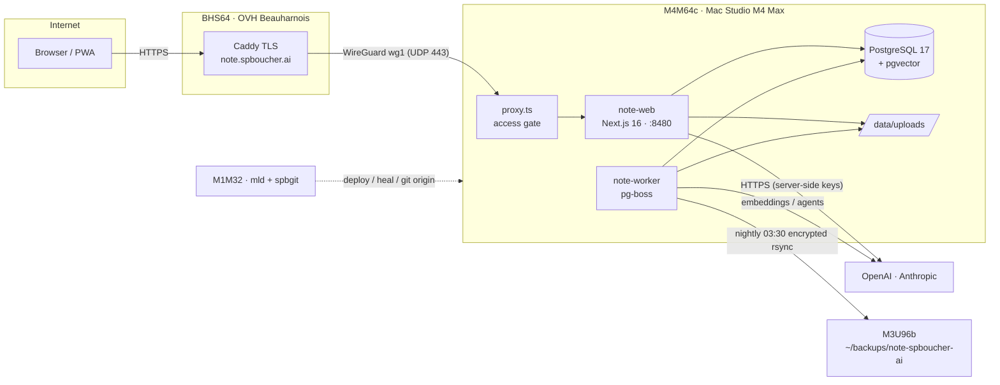

# Note SPBoucher AI

[](https://note.spboucher.ai)
[](#changelog)
[](https://nextjs.org)
[](https://react.dev)
[](https://tailwindcss.com)
[](https://github.com/pgvector/pgvector)
[](docs/ai-routing-strategy.md)
[](#deployment)
[](#access-model)
[](#licence)

Private, AI-native personal knowledge operating system for one owner — **https://note.spboucher.ai**.

Pages with a block editor, Notion-style databases, hybrid semantic search with grounded answers and citations, a knowledge graph with AI-suggested links, a research workspace, controlled AI agents and encrypted backups — on one PostgreSQL, served from a Mac Studio of the MacLustr cluster through the MacLustr Tunnel.

---

## Contents
[Features](#features) · [Architecture](#architecture) · [Access model](#access-model) · [Deployment](#deployment) · [Development](#development) · [Configuration](#configuration) · [Operations](#operations) · [Model routing](#model-routing) · [Changelog](#changelog)

## Features

| Area | What you get |
|---|---|
| **Editor** | Tiptap 3 / ProseMirror JSON: headings, lists, task lists, tables, code (lowlight), KaTeX math, callouts, toggles, `@` page mentions, `/` slash menu, drag handles, files/images, YouTube; autosave (800 ms debounce, offline queue + beacon), version history (≤ 200 snapshots), covers (gradient gallery or URL) and emoji icons. |
| **Databases** | Table · Board · List · Gallery · Calendar · Timeline views; relations, rollups, formulas, AI properties; filters/sorts/grouping; CSV import; templates (Research papers, Tasks, Reading list); sticky headers, consistent 36 px rows, keyboard cell navigation. |
| **Search & RAG** | Hybrid retrieval — pgvector HNSW (cosine, `text-embedding-3-small`) + `tsvector` (fr/en) + `pg_trgm`, reciprocal-rank fusion; ⌘K palette (titles ↔ content with Tab); RAG chat panel with numbered citations rendered as chips that jump to the cited block. |
| **Knowledge graph** | Canvas force graph (pages, databases, rows, research, files, tags), filters, AI-suggested links to review, per-page connections card, backlinks explorer. |
| **AI** | Measured routing across OpenAI + Anthropic (task classes, fallbacks, refusal retry, daily budget guard), inline AI on selection (⌘J), model dashboard and side-by-side compare, usage and cost per call. |
| **Agents** | Fixed tool allow-list, proposals with approval before writes, execution log. |
| **Research** | References (BibTeX/DOI import, `.bib` export), PDFs, experiments, tasks, LaTeX snippets. |
| **Shell** | Sidebar with workspace tree, databases, pinned pages, ⌘K search and quick capture; breadcrumb top bar; focus mode; keyboard-shortcut sheet (⌘?); mobile bottom bar + swipe drawer down to 360 px; PWA (installable, offline fallback). |
| **Design** | "Graphite & Ultramarine" tokens (OKLCH), designed light *and* dark themes, 16 px / 1.75 reading type, 46 rem measure, skeletons, empty states, visible focus rings, `prefers-reduced-motion` honoured. |
| **Data ownership** | Import Markdown/Notion ZIP/DOCX/PDF/CSV/BibTeX/JSON; export Markdown/HTML/CSV/JSON/ZIP; nightly encrypted backups with off-node copy and a tested restore. |

## Architecture



- **One process for UI + API** (App Router, route handlers, SSE streaming); secrets never leave the server.
- **One database for everything**: relational core, JSONB blocks, embeddings, full-text, job queue (pg-boss uses `SKIP LOCKED`).
- Details: [`docs/architecture.md`](docs/architecture.md).

## Access model

No account, no login form for a user, no TOTP. Any request without the device cookie gets a **neutral lock screen** (one password field, `noindex`) rendered in place; API calls get `401`.

| Way in | How | Result |
|---|---|---|
| Shared password | type it on the lock screen → `POST /api/gate` (Argon2id verify, 5 failures/min/IP, 30/min global, delay + audit on failure) | 303 to the page you asked for + cookie |
| Bookmark | `https://note.spboucher.ai/unlock/<ACCESS_KEY>` (or `?k=` on any path); URL kept in `~/Desktop/Cluster/secrets/note-spboucher-ai/unlock-url` | 303 to `/` + cookie |

Cookie `__Host-note_access` — HttpOnly · Secure · SameSite=Lax · 400 days; value = `HMAC-SHA256(ACCESS_KEY, "note-access-v1|" + ACCESS_PASSWORD_HASH)`. **Why not fully open:** the hostname is public in certificate-transparency logs and the app holds private notes and API keys. `robots.txt` disallows everything; every response carries `X-Robots-Tag: noindex`.

Rotation (on the node, then `pm2 restart note-web`): `pnpm access:password` (new password → every device locked out) · `pnpm access:rotate-key` (new bookmark → old link 404s). Lock one device from the sidebar (**Lock**). Full procedure: [`docs/security.md`](docs/security.md#access-model-and-rotation).

## Deployment

| Item | Value |
|---|---|
| Node | **M4M64c** (pinned) — `~/apps/note-spboucher-ai` (git clone, `origin` = spbgit `gitsrv:srv/git/note-spboucher-ai.git`) |
| Public URL | https://note.spboucher.ai — Caddy route on BHS64 → wg1 `10.67.0.33:8480` |
| mld manifest | `M1M32:~/dispatch/apps/note-spboucher-ai.json` (health `/api/health`, post-sync hooks: install → build → migrate → seed AI catalogue) |
| PM2 | `note-web` (`next start -p 8480 -H 0.0.0.0`, max 3 GB) · `note-worker` (`tsx src/worker/index.ts`, max 2 GB) |
| Database | PostgreSQL 17 (Homebrew, localhost) DB `note_spboucher`, role `note`; extensions `vector`, `pg_trgm`, `unaccent` |
| Crons (pg-boss, in the worker) | backup `30 3 * * *` America/Toronto → `~/backups/note-spboucher-ai` + rsync to **M3U96b** `~/backups/note-spboucher-ai/` (sha256 re-checked remotely) |
| Supervision | `mld heal` every 5 min (PM2 + Caddy route + wg1), `mld status --live` |

Remote-first update loop (never edit the laptop mirror):

```bash
ssh M4M64c
cd ~/apps/note-spboucher-ai
# edit …
set -a && . ./.env && set +a && pnpm build
pm2 restart note-web note-worker
git add -A && git commit -m "…" && git push origin main
```

More: [`docs/deployment.md`](docs/deployment.md).

## Development

```bash
pnpm install
cp .env.example .env              # fill secrets (never commit)
pnpm db:migrate && pnpm seed:ai   # schema + AI model catalogue from benchmarks/results
pnpm bootstrap                    # owner row + workspace (interactive)
pnpm access:password              # shared password hash + ACCESS_KEY into .env
pnpm dev                          # http://localhost:8480  → open /unlock/<ACCESS_KEY>
pnpm worker                       # background jobs (indexing, imports, backups, agents)
pnpm typecheck                    # tsc --noEmit
pnpm build && pnpm start          # production
pnpm bench:discover && pnpm bench:run && pnpm bench:report && pnpm seed:ai   # re-run Phase Zero
NOTE_UNLOCK_URL="$(cat ~/Desktop/Cluster/secrets/note-spboucher-ai/unlock-url)" bash scripts/smoke.sh   # post-deploy smoke test
```

Conventions (Drizzle snake_case, postgres-js, route `handler()` wrapper, zod bodies): [`docs/dev-conventions.md`](docs/dev-conventions.md).

## Configuration

All values live only in `M4M64c:~/apps/note-spboucher-ai/.env` (mode 600; copy of record in `~/Desktop/Cluster/secrets/note-spboucher-ai/`). Never commit them.

| Variable | Purpose |
|---|---|
| `NODE_ENV`, `PORT`, `TZ` | runtime (`production`, `8480`, `America/Toronto`) |
| `APP_URL` | public origin (`https://note.spboucher.ai`) — origin checks and absolute redirects |
| `APP_VERSION` | shown by `/api/health` |
| `DATABASE_URL` | PostgreSQL connection (localhost) |
| `ACCESS_KEY` | bookmark-unlock key, ≥ 32 chars (32 random bytes base64url); also the HMAC key of the cookie |
| `ACCESS_PASSWORD_HASH` | `b64:` + base64url of the Argon2id PHC string of the shared password |
| `OPENAI_API_KEY`, `ANTHROPIC_API_KEY` | providers (server-side only) |
| `DATA_DIR` | uploads root (`./data`) |
| `BACKUP_DIR`, `BACKUP_PASSPHRASE`, `BACKUP_OFFSITE`, `BACKUP_KEEP_DAYS` | encrypted backups and off-site target |
| `LOG_LEVEL` | pino level |
| `SESSION_SECRET`, `WEBAUTHN_RP_ID`, `WEBAUTHN_ORIGIN` | legacy (pre-2026-11-09 login), unused |

## Operations

- Health: `curl https://note.spboucher.ai/api/health` → `{ ok, db, pgvector }` (public, no cookie needed).
- Logs: `pm2 logs note-web --nostream` (gate attempts are `[gate]` lines), `pm2 logs note-worker --nostream`.
- Backups/restore, re-indexing, migrations rollback, budget: [`docs/operations.md`](docs/operations.md).
- Security model, threat list, rotation: [`docs/security.md`](docs/security.md).
- AI evidence: [`docs/ai-provider-discovery.md`](docs/ai-provider-discovery.md), [`docs/openai-model-benchmarks.md`](docs/openai-model-benchmarks.md), [`docs/anthropic-model-benchmarks.md`](docs/anthropic-model-benchmarks.md), [`docs/ai-model-comparison.md`](docs/ai-model-comparison.md).

## Model routing

Measured on 2026-11-01 (836 runs, 38 models); the table is seeded into `ai_models` and read by `src/lib/ai/router.ts` — see [`docs/ai-routing-strategy.md`](docs/ai-routing-strategy.md).

| Task class | Primary | Fallback | Notes |
|---|---|---|---|
| `chat` — RAG Q&A | `gpt-6-sol` | `claude-sonnet-5-5` | citations required |
| `quick` — titles, tags, AI properties | `claude-haiku-5-5` | `gpt-5.4-mini` | low effort |
| `write` — drafting, FR/EN | `gpt-6-sol` | `claude-sonnet-4-6` | |
| `reason` — maths, contradictions | `claude-opus-5-5` | `gpt-6-astra` | high effort |
| `deep` — research synthesis | `claude-fable-5-1` | `gpt-6-astra` | cost warning |
| `code` | `gpt-5.3-codex` | `claude-sonnet-5-5` | |
| `extract` — JSON | `gpt-5.4-mini` | `claude-haiku-5-5` | strict schema |
| `longctx` — > 60K tokens | `gpt-6.1-terra` | `claude-sonnet-5-5` | never the 3 refusing models |
| `agent` — tool loops | `claude-sonnet-5-5` | `gpt-5.4` | approval gates |
| `judge` | `claude-haiku-5-5` | `gpt-5.4-mini` | |
| `embed` | `text-embedding-3-small` | — | 1536-d, index versioned |

## Changelog

### 1.1.0 — 2026-11-09
- **Access:** login/password/TOTP/passkey flow removed. New neutral password gate (Argon2id hash in `.env`, 5/min/IP + 30/min global limit, audited) and bookmark unlock `/unlock/<key>`, both issuing a 400-day HMAC device cookie; `robots.txt` + `noindex` everywhere; `pnpm access:password` / `access:rotate-key`; Settings → Access with *Lock this device*.
- **Look:** new "Graphite & Ultramarine" design tokens with a designed dark theme; redesigned sidebar (search, quick capture, databases, workspace tree, lock), breadcrumb top bar, command palette with key hints, grouped shortcuts sheet, page headers with gradient covers and large icons, 46 rem reading measure and new type scale, database tables with sticky headers and consistent rows, refined board/list, RAG citations as chips, dotted graph canvas, skeleton loading states, focus rings, reduced-motion support, new PWA icons/theme colour.
- Fixed: the home dashboard jumped to the chat widget on load; long page titles were clipped on mobile.
- Removed unused dependencies `@simplewebauthn/*`, `otplib`, `qrcode`.

### 1.0.0 — 2026-11-01
- First production release on M4M64c via `mld` (Phase Zero benchmarks, editor, databases, hybrid search, graph, research, agents, backups).

## Licence

Private software of Simon-Pierre Boucher. All rights reserved — not for redistribution.
