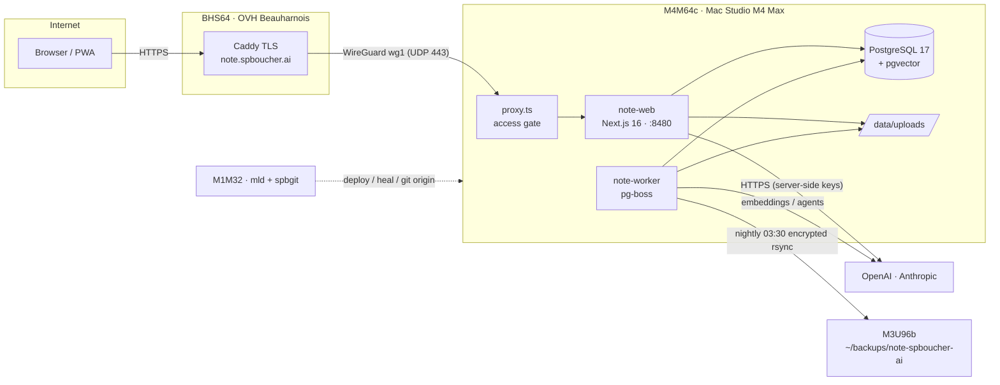

# Note SPBoucher AI

[](https://note.spboucher.ai)
[](#changelog)
[](https://nextjs.org)
[](https://react.dev)
[](https://tailwindcss.com)
[](https://github.com/pgvector/pgvector)
[](docs/ai-routing-strategy.md)
[](#deployment)
[-2ea44f?style=flat-square)](#access-model)
[](#licence)

Private, AI-native personal knowledge operating system for one owner — **https://note.spboucher.ai**.

Phone-first: quick capture to an inbox, an editor built for the thumb, offline drafts. Pages with a block editor, Notion-style databases, hybrid semantic search with grounded answers and citations, a knowledge graph with AI-suggested links, a research workspace, controlled AI agents and encrypted backups — on one PostgreSQL, served from a Mac Studio of the MacLustr cluster through the MacLustr Tunnel.

---

## Contents
[Features](#features) · [Architecture](#architecture) · [Access model](#access-model) · [Deployment](#deployment) · [Development](#development) · [Configuration](#configuration) · [Operations](#operations) · [Model routing](#model-routing) · [Changelog](#changelog)

## Features

| Area | What you get |
|---|---|
| **Editor** | Tiptap 3 / ProseMirror JSON: headings, lists, task lists, tables, code (lowlight), KaTeX math, callouts, toggles, `@` page mentions, `/` slash menu, drag handles, files/images, YouTube; autosave (800 ms debounce) with **version-checked saves** — a note changed in two sessions is never overwritten: Compare / Keep mine / Keep theirs / Keep both, both copies kept; unsent text survives a closed tab or a dead network (IndexedDB draft, replayed once); version history (≤ 200 snapshots), covers (gradient gallery or URL) and emoji icons. |
| **Databases** | Table · Board · List · Gallery · Calendar · Timeline views; relations, rollups, formulas, AI properties; filters/sorts/grouping; CSV import; templates (Research papers, Tasks, Reading list); sticky headers, consistent 36 px rows, keyboard cell navigation. |
| **Search & RAG** | Hybrid retrieval — pgvector HNSW (cosine, `text-embedding-3-small`) + `tsvector` (fr/en) + `pg_trgm`, reciprocal-rank fusion; filters by type / space / date, highlighted excerpts, results that open at the exact paragraph and survive Back, pending/failed indexing shown with re-index commands; ⌘K palette (titles ↔ content with Tab); RAG chat panel with numbered citations rendered as chips that jump to the cited block. |
| **Knowledge graph** | Canvas force graph (pages, databases, rows, research, files, tags), filters, AI-suggested links to review, per-page connections card, backlinks explorer. |
| **AI** | Measured routing across OpenAI + Anthropic (task classes, fallbacks, refusal retry, daily budget guard), inline AI on selection (⌘J), model dashboard and side-by-side compare, usage and cost per call. |
| **Agents** | Fixed tool allow-list, proposals with approval before writes, execution log. |
| **Research** | References (BibTeX/DOI import, `.bib` export), PDFs, experiments, tasks, LaTeX snippets. |
| **Capture & inbox** | One-tap capture from anywhere (note, to-do list, link, photo, file/scan, voice memo, dictation where the browser allows) — no space or template to choose, works offline and is sent exactly once. Daily inbox review: file in a space, turn into tasks, add to a database, save as a reference (DOI lookup), tag, archive — every action has Undo. |
| **Phone** | Bottom bar (Home · Search · Capture · Inbox · More), header with a real Back, drawer with favourites/recent/spaces, editing bar docked above the keyboard (contextual for tables, code, images), sheets instead of popovers, uploads with progress/cancel/retry, databases as cards, connections as lists, every screen checked at 360 px. |
| **Shell (desktop)** | Sidebar with workspace tree, databases, favourites, ⌘K search and quick capture; breadcrumb top bar; focus mode; keyboard-shortcut sheet (⌘?); PWA (installable; only the app shell is cached, never notes). |
| **Design** | "Graphite & Ultramarine" tokens (OKLCH), designed light *and* dark themes, 16 px / 1.75 reading type, 46 rem measure, skeletons, empty states, visible focus rings, `prefers-reduced-motion` honoured. |
| **Data ownership** | Import Markdown/Notion ZIP/DOCX/PDF/CSV/BibTeX/JSON; export Markdown/HTML/CSV/JSON/ZIP; nightly encrypted backups with off-node copy and a tested restore. |

## Architecture



- **One process for UI + API** (App Router, route handlers, SSE streaming); secrets never leave the server.
- **One database for everything**: relational core, JSONB blocks, embeddings, full-text, job queue (pg-boss uses `SKIP LOCKED`).
- Details: [`docs/architecture.md`](docs/architecture.md).

## Access model

**Passkeys only** (WebAuthn) — no password, no PIN typed into the app, no secret link. The device confirms it is you with Face ID, Touch ID, a fingerprint or its passcode; the server stores a public key and never anything biometric.

| Item | Value |
|---|---|
| Sign-in | `/login` → *Continue with Face ID / Touch ID / your passkey* (usernameless, user verification required) |
| Sessions | random 256-bit token, SHA-256 stored server-side, cookie `__Host-note_session` (HttpOnly · Secure · SameSite=Lax), idle 30 days, max 90 days, rotated at sign-in and at each step-up, revocable per device or globally |
| Sensitive actions | passkey again if the last verification is older than 5 minutes (passkey management, signing other devices out, whole-workspace export, permanent deletion) |
| First passkey / recovery | only through a one-time link opened from the node shell: `pnpm auth:open-enrollment` (first passkey, 15 min) · `pnpm auth:recover` (all devices lost). The window closes after one registration and at every restart. |
| Manage | Settings → Security: add / rename / remove passkeys (never the last one), devices & sessions, lock this device, activity log |
| Origin / RP ID | `https://note.spboucher.ai` / `note.spboucher.ai` (from `APP_URL`) |

Shell commands: `pnpm auth:status | auth:open-enrollment [min] | auth:recover [min] [--keep-passkeys] | auth:close-enrollment | auth:revoke-sessions`. Full model, limits and runbooks (stolen session, lost devices): [`docs/security.md`](docs/security.md).

## Deployment

| Item | Value |
|---|---|
| Node | **M4M64c** (pinned) — `~/apps/note-spboucher-ai` (git clone, `origin` = spbgit `gitsrv:srv/git/note-spboucher-ai.git`) |
| Public URL | https://note.spboucher.ai — Caddy route on BHS64 → wg1 `10.67.0.33:8480` |
| mld manifest | `M1M32:~/dispatch/apps/note-spboucher-ai.json` (health `/api/health`, post-sync hooks: install → build → migrate → seed AI catalogue) |
| PM2 | `note-web` (`next start -p 8480 -H 0.0.0.0`, max 3 GB) · `note-worker` (`tsx src/worker/index.ts`, max 2 GB) |
| Database | PostgreSQL 17 (Homebrew, localhost) DB `note_spboucher`, role `note`; extensions `vector`, `pg_trgm`, `unaccent` |
| Crons (pg-boss, in the worker) | backup `30 3 * * *` America/Toronto → `~/backups/note-spboucher-ai` + rsync to **M3U96b** `~/backups/note-spboucher-ai/` (sha256 re-checked remotely) |
| Supervision | `mld heal` every 5 min (PM2 + Caddy route + wg1), `mld status --live` |

Remote-first update loop (never edit the laptop mirror):

```bash
ssh M4M64c
cd ~/apps/note-spboucher-ai
# edit …
set -a && . ./.env && set +a && pnpm build
pm2 restart note-web note-worker
git add -A && git commit -m "…" && git push origin main
```

More: [`docs/deployment.md`](docs/deployment.md).

## Development

```bash
pnpm install
cp .env.example .env              # fill secrets (never commit)
pnpm db:migrate && pnpm seed:ai   # schema + AI model catalogue from benchmarks/results
pnpm run bootstrap                # owner row + workspace (no password: access is by passkey)
pnpm auth:open-enrollment         # one-time link to register the first passkey
pnpm dev                          # use another port and a *_dev database, never the production folder
pnpm worker                       # background jobs (indexing, imports, backups, agents)
pnpm typecheck                    # tsc --noEmit
pnpm test                         # unit/integration (WebAuthn attacks, sessions, conflicts, inbox, jobs) on a *_dev database
pnpm test:e2e                     # Playwright: passkey journeys (virtual authenticator) + phone journeys at 360/375/430 px
pnpm build && pnpm start          # production
pnpm bench:discover && pnpm bench:run && pnpm bench:report && pnpm seed:ai   # re-run Phase Zero
bash scripts/smoke.sh               # post-deploy smoke test (public surface, no credential)
```

Conventions (phone-first UI rules, `handler()` wrapper, migrations, logging): [`docs/dev-conventions.md`](docs/dev-conventions.md). What the tests prove and the manual iPhone/Android pass: [`docs/testing.md`](docs/testing.md).

## Configuration

All values live only in `M4M64c:~/apps/note-spboucher-ai/.env` (mode 600; copy of record in `~/Desktop/Cluster/secrets/note-spboucher-ai/`). Never commit them.

| Variable | Purpose |
|---|---|
| `NODE_ENV`, `PORT`, `TZ` | runtime (`production`, `8480`, `America/Toronto`) |
| `APP_URL` | public origin (`https://note.spboucher.ai`) — the only origin accepted for passkeys and mutating requests; its host is the passkey RP ID |
| `AUTH_RP_ID` | optional; leave unset (changing it invalidates every passkey) |
| `APP_VERSION` | shown by `/api/health` |
| `DATABASE_URL` | PostgreSQL connection (localhost) |
| `OPENAI_API_KEY`, `ANTHROPIC_API_KEY` | providers (server-side only) |
| `DATA_DIR` | uploads root (`./data`) |
| `BACKUP_DIR`, `BACKUP_PASSPHRASE`, `BACKUP_OFFSITE`, `BACKUP_KEEP_DAYS` | encrypted backups and off-site target |
| `LOG_LEVEL` | pino level |
| `ACCESS_KEY`, `ACCESS_PASSWORD_HASH`, `SESSION_SECRET`, `WEBAUTHN_RP_ID`, `WEBAUTHN_ORIGIN` | obsolete since 2.0 — ignored; delete them from `.env` after the first passkeys are enrolled |

## Operations

- Health: `curl https://note.spboucher.ai/api/health` → `{ ok, db, pgvector, worker, passkeys }` (public, booleans only).
- Logs: `pm2 logs note-web|note-worker --nostream` — JSON lines with request/job ids, never content. In the app: Settings → Jobs and Settings → Indexing.
- Backups/restore, re-indexing, migrations rollback, budget: [`docs/operations.md`](docs/operations.md).
- Security model, threat list, rotation: [`docs/security.md`](docs/security.md).
- AI evidence: [`docs/ai-provider-discovery.md`](docs/ai-provider-discovery.md), [`docs/openai-model-benchmarks.md`](docs/openai-model-benchmarks.md), [`docs/anthropic-model-benchmarks.md`](docs/anthropic-model-benchmarks.md), [`docs/ai-model-comparison.md`](docs/ai-model-comparison.md).

## Model routing

Measured on 2026-11-01 (836 runs, 38 models); the table is seeded into `ai_models` and read by `src/lib/ai/router.ts` — see [`docs/ai-routing-strategy.md`](docs/ai-routing-strategy.md).

| Task class | Primary | Fallback | Notes |
|---|---|---|---|
| `chat` — RAG Q&A | `gpt-6-sol` | `claude-sonnet-5-5` | citations required |
| `quick` — titles, tags, AI properties | `claude-haiku-5-5` | `gpt-5.4-mini` | low effort |
| `write` — drafting, FR/EN | `gpt-6-sol` | `claude-sonnet-4-6` | |
| `reason` — maths, contradictions | `claude-opus-5-5` | `gpt-6-astra` | high effort |
| `deep` — research synthesis | `claude-fable-5-1` | `gpt-6-astra` | cost warning |
| `code` | `gpt-5.3-codex` | `claude-sonnet-5-5` | |
| `extract` — JSON | `gpt-5.4-mini` | `claude-haiku-5-5` | strict schema |
| `longctx` — > 60K tokens | `gpt-6.1-terra` | `claude-sonnet-5-5` | never the 3 refusing models |
| `agent` — tool loops | `claude-sonnet-5-5` | `gpt-5.4` | approval gates |
| `judge` | `claude-haiku-5-5` | `gpt-5.4-mini` | |
| `embed` | `text-embedding-3-small` | — | 1536-d, index versioned |

## Changelog

### 2.0.0 — 2026-11-17
- **Access:** passkeys (WebAuthn, user verification required) replace the shared password and the `/unlock` link, which are removed. Revocable server-side sessions, step-up for sensitive actions, CLI-only bootstrap/recovery windows, device and passkey management, audit trail.
- **Phone first:** new navigation (bottom bar, header with Back, drawer), quick capture sheet with offline outbox, inbox review with undo, editing bar above the keyboard, sheets, uploads with progress, databases as cards, connections as lists, search rebuilt with filters and exact-paragraph links.
- **Reliability:** version-checked saves and explicit conflict resolution, device-local drafts, idempotent mutations (`Idempotency-Key`), request ids and structured logs without content, queue policies with dead letter, worker heartbeat and timeouts, jobs/indexing diagnostics, nothing purged automatically.
- **Privacy:** session validated before any page or API handler, service worker caches the app shell only, `no-store` on authenticated responses, AI disclosure before sending, document validation.
- Migration `0001_v2_passkeys_inbox` (additive, with rollback); upgrade procedure in `docs/deployment.md`.

### 1.1.0 — 2026-11-09
- **Access:** login/password/TOTP/passkey flow removed. New neutral password gate (Argon2id hash in `.env`, 5/min/IP + 30/min global limit, audited) and bookmark unlock `/unlock/<key>`, both issuing a 400-day HMAC device cookie; `robots.txt` + `noindex` everywhere; `pnpm access:password` / `access:rotate-key`; Settings → Access with *Lock this device*.
- **Look:** new "Graphite & Ultramarine" design tokens with a designed dark theme; redesigned sidebar (search, quick capture, databases, workspace tree, lock), breadcrumb top bar, command palette with key hints, grouped shortcuts sheet, page headers with gradient covers and large icons, 46 rem reading measure and new type scale, database tables with sticky headers and consistent rows, refined board/list, RAG citations as chips, dotted graph canvas, skeleton loading states, focus rings, reduced-motion support, new PWA icons/theme colour.
- Fixed: the home dashboard jumped to the chat widget on load; long page titles were clipped on mobile.
- Removed unused dependencies `@simplewebauthn/*`, `otplib`, `qrcode`.

### 1.0.0 — 2026-11-01
- First production release on M4M64c via `mld` (Phase Zero benchmarks, editor, databases, hybrid search, graph, research, agents, backups).

## Licence

Private software of Simon-Pierre Boucher. All rights reserved — not for redistribution.
