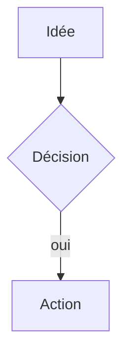

Ventes par trimestre

| Trimestre | Ventes | Marge |
| --- | --- | --- |
| T1 | 120 | 0.25 |
| T2 | 135.5 | 0.3 |
| T3 |  |  |

[Vue: Tâches ouvertes]

Comme le montre [@Bollerslev 1986], la variance conditionnelle est persistante.

## Références

[PDF: article.pdf](/api/files/33333333-3333-4333-8333-333333333333)

> p.3 — Volatility clustering is pervasive. — À citer dans l'introduction
> p.7 — Vérifier l'équation 4

[[aaaaaaaa-aaaa-4aaa-8aaa-aaaaaaaaaaaa#par0000009]]

```javascript
const xs = [1, 2, 3];
console.log(xs.reduce((a, b) => a + b, 0));
```

```output
6
```

[Audio: Réunion de laboratoire](/api/files/22222222-2222-4222-8222-222222222222)

[00:00] Bonjour à tous.
[00:12] On commence par les résultats du modèle.
[01:05] Prochaine étape : rédiger la section 3.

[Canvas](/p/bbbbbbbb-bbbb-4bbb-8bbb-bbbbbbbbbbbb)
