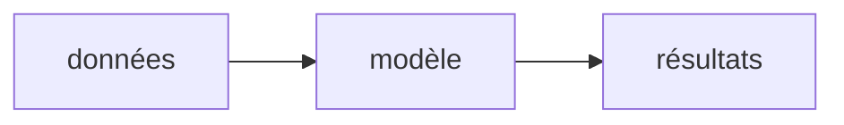

# Journal de recherche

Hypothèse de départ, voir [@Nelson 1991].

> [!DECISION] ✅
> On retient le modèle EGARCH.

- [ ] Relancer l'estimation
- [x] Nettoyer les données

- Point A [@Nelson 1991]
- Point B

## Résultats

Log-vraisemblance

| Modèle | LL |
| --- | --- |
| GARCH | -1234.5 |
| EGARCH | -1201 |

> [!AI] claude-x
> Synthèse proposée.

[Canvas](/p/bbbbbbbb-bbbb-4bbb-8bbb-bbbbbbbbbbbb)

[[aaaaaaaa-aaaa-4aaa-8aaa-aaaaaaaaaaaa#par0000009]]

## Bibliographie
